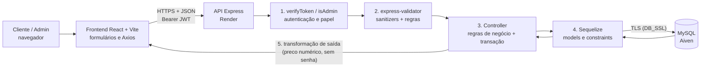

# Adega do Rei — Backend (API REST)

API em **Node.js + Express** com **Sequelize + MySQL**, autenticação **JWT**, senhas com **bcrypt** e validação com **express-validator**, seguindo a arquitetura **MVC**.

## Como rodar

```bash
cd src/backend        # (ou a pasta onde este backend estiver)
npm install
cp .env.example .env  # preencha DB_PASSWORD e troque o JWT_SECRET
# crie o banco no MySQL/DBeaver:  CREATE DATABASE adega_do_rei;
npm run seed:admin    # cria o usuário administrador
npm run dev           # sobe em http://localhost:3000
```

As tabelas (`usuarios`, `produtos`, `movimentacoes_estoque`) são criadas automaticamente pelo Sequelize (`sync`) na primeira execução.

```bash
npm test              # 56 testes de validação, regras de negócio e integridade
```

## Estrutura (MVC)

```
src/
├── config/database.js        # conexão Sequelize/MySQL
├── models/                   # Model: User, Product, StockMovement
├── controllers/              # Controller: regras de cada rota
├── routes/                   # Rotas: URL -> middlewares -> controller
├── middlewares/              # verifyToken, isAdmin, validate
├── validators/               # regras do express-validator
├── utils/cpf.js              # validação de CPF e maioridade
├── utils/normalize.js        # limpeza e padronização de textos, categoria e preço
├── seeders/createAdmin.js    # cria o admin
├── app.js                    # configuração do Express
└── server.js                 # conexão com o banco + listen
```

## Rotas

| Método | Rota | Acesso | Descrição |
|---|---|---|---|
| POST | `/api/auth/register` | Público | Cadastro de cliente (valida CPF, maioridade e senha) |
| POST | `/api/auth/login` | Público | Login, retorna o token JWT |
| GET | `/api/auth/me` | Token | Dados do usuário logado |
| GET | `/api/produtos` | Público | Lista o catálogo (`?categoria=`) |
| GET | `/api/produtos/:id` | Público | Detalhe do produto |
| POST | `/api/produtos` | Admin | Cadastra produto |
| PUT | `/api/produtos/:id` | Admin | Atualiza produto |
| PATCH | `/api/produtos/:id/estoque` | Admin | Entrada de estoque (`{"quantidade": 12, "motivo": "opcional"}`) |
| GET | `/api/produtos/:id/movimentacoes` | Admin | Histórico de movimentações do estoque do produto |
| DELETE | `/api/produtos/:id` | Admin | Remove do catálogo (exclusão lógica) |

Rotas protegidas exigem o header `Authorization: Bearer <token>`.

## Segurança

- Senhas guardadas apenas como hash **bcrypt** (10 rounds); o hash nunca é retornado nas consultas.
- **JWT** com expiração; `verifyToken` bloqueia requisições sem token válido (401).
- Controle de acesso por papel (`isAdmin`): cliente autenticado recebe 403 em rotas de admin.
- O papel do usuário nunca vem do corpo da requisição no cadastro (evita escalada de privilégio).
- Mensagem de login genérica, sem revelar se o e-mail existe.
- Entradas validadas e sanitizadas com **express-validator** antes de chegar ao controller.
- Segredos ficam no `.env` (fora do Git).

## Tratamento, validação e transformação de dados

### Fluxo de integração (fontes de dados → aplicação)



Cada dado percorre cinco camadas, e cada uma tem uma responsabilidade:

| Etapa | Onde | O que faz |
|---|---|---|
| 1. Acesso | `middlewares/verifyToken.js`, `isAdmin.js` | Valida o JWT e o papel antes de qualquer dado ser lido (401/403) |
| 2. Validação e sanitização | `validators/*.js`, `utils/*.js` | Limpa e padroniza a entrada; rejeita o que viola as regras (400 com campo e mensagem) |
| 3. Regras de negócio | `controllers/*.js` | Duplicidade (409), existência (404), transação saldo + histórico |
| 4. Persistência | `models/*.js` | Tipos, `allowNull`, `unique`, `min` e ENUMs como última barreira no banco |
| 5. Saída | `Product.toJSON`, scope `defaultScope` do `User` | `preco` volta como número; hash da senha nunca sai |

Fontes de dados: o formulário do frontend (entrada), o MySQL na Aiven (persistência) e as variáveis de ambiente do Render (configuração e segredos). O frontend não grava no banco: tudo passa pela API.

### Regras de tratamento aplicadas

| Dado | Tratamento (entrada) | Validação |
|---|---|---|
| Nome (usuário/produto) | Remove tags HTML, caracteres de controle e espaços repetidos; preserva apóstrofo | 3–100 (usuário) ou até 120 (produto) caracteres |
| E-mail | Normalizado (minúsculas); o admin do seed usa a mesma normalização | Formato válido; único |
| CPF | Remove máscara (`111.444.777-35` → `11144477735`) | 11 dígitos, dígitos verificadores, não aceita sequência repetida; único |
| Data de nascimento | — | `AAAA-MM-DD`, existente no calendário, 18 anos ou mais (RN01) |
| Senha | Hash bcrypt (10 rounds) | Mínimo 8 caracteres, com letra e número |
| Categoria | `vinho   tinto` → `Vinho Tinto` (mesmo tratamento no filtro `?categoria=`) | Obrigatória, até 60 caracteres |
| Preço | Arredondado a 2 casas | Maior que zero |
| Volume, descrição | `null`/vazio aceitos; descrição vazia vira `null` | Volume: inteiro positivo |
| Estoque / quantidade | — | Estoque inicial ≥ 0; entrada: inteiro ≥ 1 |

### Inconsistências encontradas e tratadas

| Inconsistência | Antes | Depois | Teste |
|---|---|---|---|
| Apóstrofo gravado codificado | `Jack Daniel&#x27;s` no banco (o `.escape()` alterava o dado e o React escapa de novo na tela) | `Jack Daniel's` | "padroniza categoria e preserva apóstrofo no nome" |
| Produto sem volume ou descrição | Frontend envia `null` e a API respondia 400 (`volumeMl: null` não era aceito) | Aceito | "aceita o payload exato do frontend" |
| Preço devolvido como texto | MySQL `DECIMAL` chegava como `"89.90"`, mas o tipo `Produto` espera número | `89.9` (número) | "arredonda preço... devolve preço como número" |
| Categorias duplicadas por digitação | `vinho tinto`, `Vinho  Tinto` viravam categorias diferentes | Padronizadas | "filtro por categoria é tolerante..." |
| Produto duplicado | Permitia o mesmo nome e volume duas vezes | 409, sem diferenciar maiúsculas | "rejeita produto duplicado" |
| Atualização parcial | Campo ausente podia ser enviado como `undefined` ao banco | Só os campos enviados são alterados | "atualização parcial mantém os demais campos" |
| Saldo sem rastro | Entrada de estoque alterava o saldo sem histórico (RN06) | Saldo e histórico na mesma transação; falha em um desfaz o outro | "transação: se o histórico falhar..." |
| Login do admin | Seed gravava o e-mail sem normalizar, e o login normaliza | Seed usa a mesma normalização | — |

Tratamento de erros: toda rejeição de validação responde `400` com `{ erro, detalhes: [{ campo, mensagem }] }`; duplicidade `409`; não encontrado `404`; credencial inválida `401` com mensagem genérica; papel insuficiente `403`; JSON malformado `400`; falha interna `500` (o detalhe vai só para o log do servidor).

### Evidências de validação

- `npm test` executa 56 testes (`tests/unit.test.js` e `tests/api.test.js`), todos aprovados. A saída completa está em `docs/evidencias/resultado-testes.txt`.
- Os testes de API usam SQLite em memória no lugar do MySQL, para não tocar nos dados da Aiven. Validators, controllers, middlewares e models são os mesmos de produção.
- Em produção, foram verificados manualmente na nuvem: conexão com a Aiven, criação das tabelas, seed do admin e login pela URL do Render.
- Cobertura por regra: RN01 (maioridade), RN06 (histórico de estoque), RN07 e RNF03 (acesso por papel), RNF02 (hash e mensagem genérica de login), RNF10 (transação). A tabela completa está em `docs/rn.md`.

## Nuvem (Aiven + Render)

Toda configuração de nuvem é feita por variáveis de ambiente — nenhum código muda entre
rodar localmente e rodar em produção.

- **Banco de dados (Aiven):** copie `DB_HOST`, `DB_PORT`, `DB_NAME`, `DB_USER` e
  `DB_PASSWORD` do painel do serviço MySQL na Aiven, defina `DB_SSL=true` e, se quiser
  validar o certificado (recomendado), baixe o `ca.pem` do painel e aponte
  `DB_SSL_CA_PATH` para ele. Sem SSL o Aiven recusa a conexão.
- **API (Render):** conecte o repositório do GitHub, defina como diretório raiz do
  serviço `src/backend`, comando de build `npm install`, comando de start `npm start`,
  e cadastre todas as variáveis do `.env.example` no painel do Render (incluindo as do
  Aiven acima e o `CORS_ORIGIN` apontando para a URL pública do frontend).
- O Render define sua própria `PORT` automaticamente; o `server.js` já lê
  `process.env.PORT`, então nada precisa ser alterado para isso.
